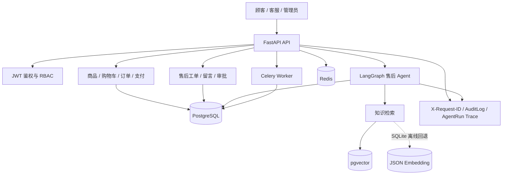
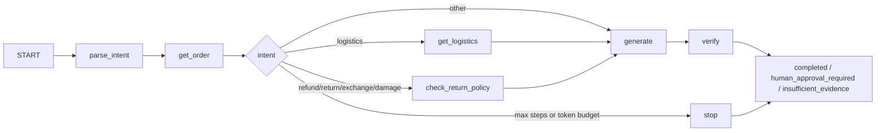
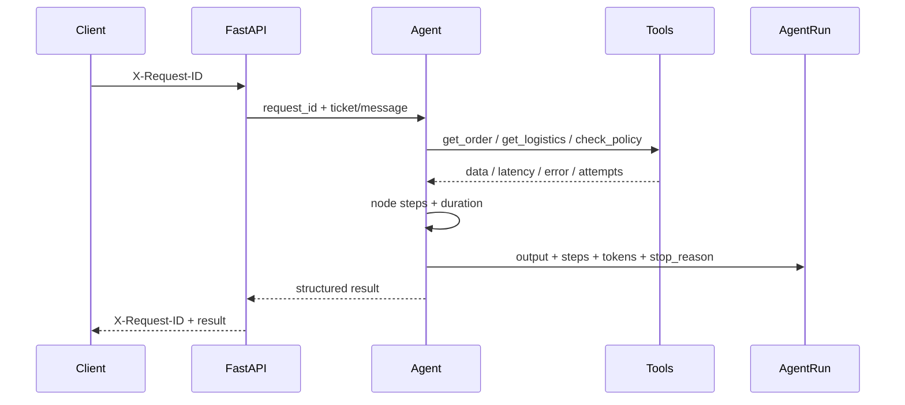

# ShopAgent 架构说明

## 1. 总体架构

## 2. Agent 工作流

## 3. 为什么这样设计

### Agent 不是自由聊天

Agent 的输出必须符合固定结构：

- intent
- summary
- evidence
- missing_information
- recommended_action
- requires_human_approval
- confidence

这样前端、审批流程和评测都能消费同一份结果。

### 工具只读

订单、物流和政策检索工具都是只读的。高风险退款、退货、换货和赔付只生成建议，不直接执行。

### 确定性代码优先

权限、订单状态、库存扣减、金额和退款审批条件都放在后端代码中。模型只负责自然语言理解和草稿生成。

### 离线也能运行

- 没有模型 Key 时使用规则引擎兜底。
- 没有 Redis 时使用 fakeredis。
- 没有 Celery broker 时使用 eager 模式。
- SQLite 下使用 JSON Embedding，PostgreSQL 下切换 pgvector。

## 4. 可观测性

可追踪信息：

- 每个 HTTP 请求的 request_id
- 每个 Agent 节点的耗时
- 每次工具调用状态、重试次数和延迟
- 模型名与 Prompt 版本
- Token 和总延迟
- 停止原因和错误

## 5. 评测设计

三套方案：

1. 纯规则基线
2. 规则 + RAG
3. 规则 + RAG + 工具 + 校验

当前 30 条案例用于验证：

- 意图识别
- 人工审批判断
- 政策引用覆盖
- 无证据结论
- 工具成功率
- P50/P95 延迟
- 平均 Token

评测结果写入 `eval/reports/agent_latest.md` 和 `eval/reports/agent_latest.json`。
